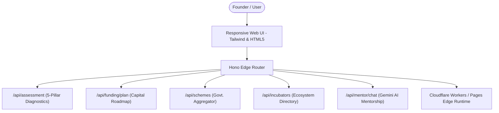

# SheLaunch AI 🚀
### *Fueling Her Vision. Funding Her Venture.*

[](LICENSE)
[](https://hono.dev/)
[](https://vitejs.dev/)
[](https://pages.cloudflare.com/)
[](https://sdgs.un.org/goals)

> **SheLaunch AI** is an intelligent ecosystem that transforms fragmented startup journeys into structured growth pathways for women entrepreneurs. It delivers instant startup readiness diagnostics, investor matchmaking, curated government scheme eligibility, incubator discovery, and round-the-clock AI mentorship.

---

## 🌟 Table of Contents
- [Problem & Mission](#-problem--mission)
- [Architecture & Tech Stack](#-architecture--tech-stack)
- [5 Core Platform Modules](#-5-core-platform-modules)
- [System Architecture Flow](#-system-architecture-flow)
- [Project Directory Structure](#-project-directory-structure)
- [Getting Started & Local Setup](#-getting-started--local-setup)
- [API Reference](#-api-reference)
- [Contributing](#-contributing)
- [License](#-license)

---

## 🎯 Problem & Mission

### The Problem
Women entrepreneurs face distinct structural barriers in the startup ecosystem:
- **Fragmented Discovery:** Government grants and support schemes are dispersed across dozens of portals with complex bureaucratic jargon.
- **Lack of Readiness Benchmarking:** Early founders lack clear quantitative visibility into whether their venture is pitch-ready or investor-viable.
- **Funding Asymmetry:** Less than 3% of global venture capital flows into female-founded startups due to network and preparation gaps.
- **Access to Mentorship:** High barrier to affordable, on-demand strategic guidance and pitch deck feedback.

### The SheLaunch Mission
Provide female founders with an AI-first co-pilot that evaluates startup health across 5 core pillars, matches capital opportunities, and guides them from idea to scale.

---

## 🏗️ Architecture & Tech Stack



- **Frontend:** Responsive UI with Tailwind CSS, FontAwesome 6, and interactive vanilla JavaScript micro-components.
- **Backend / Routing:** [Hono v4](https://hono.dev) — ultra-fast, lightweight web framework designed for edge computing.
- **Build Tool:** Vite 6 with TypeScript support.
- **Edge Deployment:** Cloudflare Pages / Workers via Wrangler.
- **AI Intelligence:** Gemini AI prompt orchestration for contextual business mentoring and pitch deck analysis.

---

## 🧩 5 Core Platform Modules

| Module | Route | Highlights |
|---|---|---|
| **1. Startup Readiness Diagnostic** | `/assessment` | Evaluates team, market size, product readiness, traction, and financials with multi-tier scoring (0-100) and gap analysis. |
| **2. Funding Intelligence Advisor** | `/funding` | Generates milestone-driven capital roadmaps (Bootstrapping, Grants, Angels, Seed, VC). |
| **3. Government Scheme Aggregator** | `/schemes` | Searchable directory of women-focused schemes (TREAD, Stand-Up India, Mudra, WEP, Startup India Seed Fund). |
| **4. Incubator & Accelerator Directory** | `/incubators` | Curated network of incubators, equity-free programs, and women-exclusive accelerator cohorts. |
| **5. 24/7 AI Strategic Mentor** | `/mentor` | Context-aware advisory agent for pitch deck teardowns, business model validation, and strategy. |

---

## 📁 Project Directory Structure

```text
codesangram-main/
├── public/                 # Static assets & stylesheets
│   └── static/style.css
├── src/
│   ├── data/
│   │   ├── incubators.ts   # Curated database of incubators & accelerators
│   │   └── schemes.ts      # Indian & global government schemes dataset
│   ├── pages/
│   │   ├── assessment.tsx  # Readiness check engine & dynamic scorecards
│   │   ├── funding.tsx     # Funding stage advisor & roadmap generator
│   │   ├── home.tsx        # Hero landing page & feature highlights
│   │   ├── incubators.tsx  # Incubator explorer & filter UI
│   │   ├── mentor.tsx      # AI chat & document feedback interface
│   │   └── schemes.tsx     # Scheme discovery portal
│   ├── index.tsx           # Hono server routing & API endpoints
│   └── renderer.tsx        # HTML renderer layout
├── ecosystem.config.cjs    # PM2 runtime configuration
├── tsconfig.json           # TypeScript configuration
├── vite.config.ts          # Vite build & bundle setup
├── wrangler.jsonc          # Cloudflare Pages deployment configuration
└── README.md
```

---

## 🚀 Getting Started & Local Setup

### Prerequisites
- [Node.js](https://nodejs.org/) (v18.0.0 or higher recommended)
- `npm` or `pnpm`

### Installation

1. Clone the repository:
   ```bash
   git clone https://github.com/harish-k-harish/she-launch-ai.git
   cd she-launch-ai
   ```

2. Install dependencies:
   ```bash
   npm install
   ```

3. Launch development server:
   ```bash
   npm run dev
   ```
   Open [http://localhost:5173](http://localhost:5173) in your browser.

4. Build for production:
   ```bash
   npm run build
   ```

5. Preview edge build locally:
   ```bash
   npm run preview
   ```

---

## 🔌 API Reference

### Health & Metadata
- **`GET /api/health`**
  - Returns service status, module counts, and platform statistics.

### Scheme Discovery
- **`GET /api/schemes`**
  - Query parameters: `category`, `stage`, `sector`, `q` (search term).

### Incubator Discovery
- **`GET /api/incubators`**
  - Query parameters: `equity`, `stage`, `womenOnly`, `q`.

### Readiness Diagnostic
- **`POST /api/assessment`**
  - Body: `{ answers: Record<string, string>, sector: string, stage: string }`
  - Returns: `{ score: number, breakdown: object, readinessLevel: string, recommendations: string[] }`

### Funding Roadmap
- **`POST /api/funding/plan`**
  - Body: `{ stage: string, targetAmount: number, runwayMonths: number, sector: string }`
  - Returns customized milestone timeline and matched funding types.

### AI Mentor Chat
- **`POST /api/mentor/chat`**
  - Body: `{ message: string, history: Array<{ role: string, content: string }> }`
  - Returns: `{ response: string }`

---

## 🤝 Contributing

Contributions make the open-source community an empowering space to learn, inspire, and create. Any contributions to SheLaunch AI are **greatly appreciated**!

1. Fork the Project
2. Create your Feature Branch (`git checkout -b feature/AmazingFeature`)
3. Commit your Changes (`git commit -m 'feat: Add some AmazingFeature'`)
4. Push to the Branch (`git push origin feature/AmazingFeature`)
5. Open a Pull Request

---

## 📄 License

Distributed under the **MIT License**. See [`LICENSE`](LICENSE) for more information.
